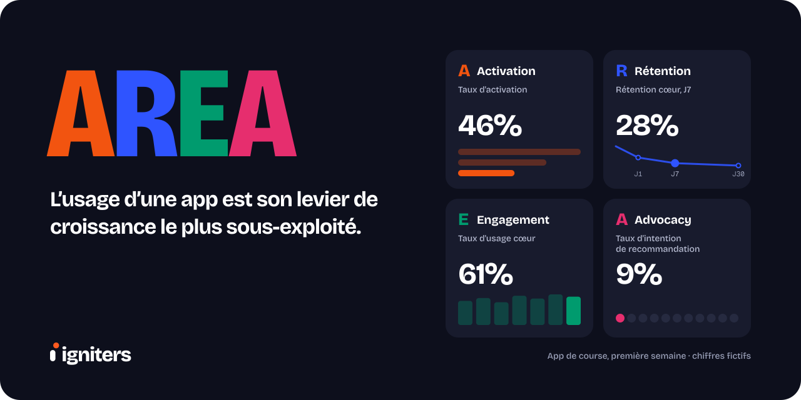
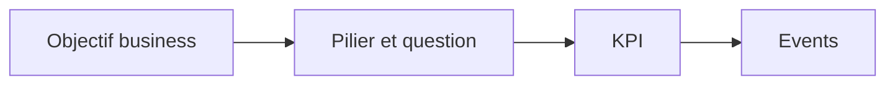

<p align="center"></p>

# AREA Framework

*Traduction de v0.2.0. La version anglaise fait référence : [English](README.md).*

**L'usage d'une app est son levier de croissance le plus sous-exploité.**

AREA dit quoi tracker et pourquoi : quatre piliers pour piloter n'importe quelle app mobile, un KPI de référence pour chacun, et les events qui les rendent lisibles. Puis tout ce que l'app veut savoir de plus.

`v0.2.0` · Texte [CC BY 4.0](LICENSE), registre [CC0 1.0](registry/LICENSE) · [English](README.md) · Français



Pas un event sans raison d'être : un event existe parce qu'un KPI en a besoin, un KPI parce qu'il répond à une question, une question parce qu'un objectif en dépend. C'est l'approche [Goal-Question-Metric](https://en.wikipedia.org/wiki/GQM), poussée jusqu'à l'event. Le plan se conçoit de l'objectif vers l'event, et se lit de l'event vers l'objectif.

## Pourquoi AREA

Beaucoup d'apps mobiles traquent beaucoup et en apprennent peu. Les events s'empilent au fil des features, les frameworks habituels ne descendent pas jusqu'aux events, et les specs d'events disent quoi envoyer sans dire pourquoi. Le détail est dans le [manifeste](spec/fr/manifesto.md).

### D'où vient AREA

Je construis des apps mobiles, et je cherchais un framework de tracking pour mesurer simplement, et de manière standard, l'usage réel de chacune d'elles : une méthode qui fonctionne d'une app à l'autre, pas un plan refait à chaque fois. J'ai trouvé [AARRR](https://www.slideshare.net/dmc500hats/startup-metrics-for-pirates-long-version) (Acquisition, Activation, Retention, Referral, Revenue), pensé pour la croissance d'une startup, [HEART](https://research.google.com/pubs/archive/36299.pdf) (Happiness, Engagement, Adoption, Retention, Task success), pensé pour l'expérience utilisateur d'un produit ou d'une feature, et des specs d'events qui disent quoi envoyer sans dire pourquoi. Les deux premiers vont de l'objectif à la métrique, puis laissent chaque projet construire ses events. Aucune des solutions existantes ne proposait une base commune, prête à poser dans n'importe quelle app mobile. Alors j'en ai écrit un.

La question suivante est arrivée aussitôt : comment m'assurer que le tracking reste juste dans la durée ? Que se passe-t-il quand j'ajoute une feature, quand je change l'interface, quand j'en retire une ? Comment faire du tracking un outil de décision qui vit avec le projet, plutôt qu'un plan qui se périme au premier sprint ? Une partie de la réponse tient dans l'outillage (voir [plus bas](#outillage)). AREA, lui, s'applique sans aucun outil.

— Kevin Tersigni, créateur d'AREA et fondateur du studio igniters

## Les quatre piliers

Les piliers sont les mêmes pour toutes les apps. Ce que chaque app définit, ce sont ses objectifs dans chacun d'eux : AREA propose pour chaque pilier un objectif type, la question qui en découle, le KPI de référence qui y répond et les events qui le calculent.

| Pilier | Objectif type | La question | KPI de référence |
|---|---|---|---|
| [**Activation**](spec/fr/pillars/activation.md) | Amener le plus de nouveaux utilisateurs possible jusqu'à la valeur de l'app, le plus vite possible | Les nouveaux utilisateurs atteignent-ils le moment où l'app prouve sa valeur ? | Taux d'activation |
| [**Rétention**](spec/fr/pillars/retention.md) | Faire revenir les utilisateurs, longtemps, pour ce que l'app leur apporte | Reviennent-ils faire ce pour quoi l'app existe ? | Rétention cœur |
| [**Engagement**](spec/fr/pillars/engagement.md) | Faire de l'action cœur une habitude, et savoir quelles features créent de la valeur | Quand ils sont là, utilisent-ils l'app pour ce qu'elle sait faire de mieux ? | Taux d'usage cœur |
| [**Advocacy**](spec/fr/pillars/advocacy.md) | Faire des utilisateurs satisfaits un levier de croissance organique et d'amélioration du produit | Sont-ils prêts à la recommander ? | Taux d'intention de recommandation |

Chaque KPI de référence se lit avec son volume, et s'accompagne d'un verdict : mesurable, partiel ou non mesurable avec le tracking en place. Celui de l'Advocacy se lit dès que l'app pose une question de satisfaction, un NPS ou propose une invitation : toutes ne le font pas.

## Appliquer AREA

1. **Fixer les objectifs de l'app, pilier par pilier**, en partant des objectifs types : chaque app écrit les siens, et ce sont eux qui disent pourquoi un pilier compte.
2. **Définir l'action cœur** de l'app, puis son **aha moment**, comme une hypothèse à vérifier sur les données. Tout le reste en dépend ([Engagement](spec/fr/pillars/engagement.md), [Activation](spec/fr/pillars/activation.md)).
3. **En déduire les KPI** : les quatre KPI de référence d'abord, puis ceux des questions propres à l'app.
4. **Lister les mécaniques** de l'app : onboarding, autorisations, notifications, partage, parrainage… Chacune apporte ses events ([Minimum Viable Tracking](spec/fr/mvt.md)).
5. **Poser les [Fondations](spec/fr/foundations.md) et implémenter le Minimum Viable Tracking** : identité, propriétés communes, consentement, séparation des données de test, puis les events, selon les [conventions](spec/fr/conventions.md).
6. **Vérifier que chaque KPI est mesurable** : mesurable, partiel ou non mesurable, le verdict dit si les bons events remontent et ce qu'il faut corriger d'abord. La lecture des KPI se fait ensuite dans l'outil d'analytics ou de BI de l'équipe, où l'on vérifie l'aha moment. Jamais d'event sans question.

## Quand utiliser AREA

- **Avant la première ligne de code d'une nouvelle app**, pour écrire le plan de tracking.
- **Pour auditer une app existante** : son tracking permet-il de lire les quatre piliers ? Ses events existants peuvent garder leur nom et jouer les rôles du socle ([Minimum Viable Tracking](spec/fr/mvt.md#des-rôles-pas-seulement-des-noms)).
- **À chaque nouvelle feature**, pour la rattacher aux piliers plutôt que de lui inventer ses propres métriques.

AREA se pense à l'échelle de l'app entière. Une feature n'a pas son propre framework : elle se rattache aux quatre piliers, et ses questions propres s'ajoutent au-delà du Minimum Viable Tracking.

## Le Minimum Viable Tracking en bref

Peu d'events, bien choisis, suffisent pour décider. Le [Minimum Viable Tracking](spec/fr/mvt.md) est le plus petit plan qui rend les piliers lisibles. Il se construit en trois couches : les Fondations, un socle de trois events obligatoires dans toute app (`app_opened`, `aha_moment_reached`, `core_action_completed`), et les events des mécaniques que l'app contient. Une mécanique, c'est une fonction que l'app a ou n'a pas : un onboarding, des notifications, une demande d'autorisation, un parrainage… Si l'app l'a, ses events entrent dans le plan. Pour une app courante, une douzaine d'events suffit à lire les quatre piliers.

## AREA et les autres frameworks

AREA ne remplace pas les frameworks existants. Il leur emprunte beaucoup, et ajoute ce qu'ils laissent à chaque projet : le plan d'events.

| | AARRR | HEART | AREA |
|---|---|---|---|
| Pour mesurer | La croissance d'une startup, de l'acquisition au revenu | L'expérience utilisateur | L'usage d'une app mobile |
| Échelle | Le business | Le produit ou une feature | L'app entière |
| Ce qu'AREA lui emprunte | L'Activation, la Rétention, et le Referral devenu Advocacy | L'Engagement, et la chaîne objectif → signal → métrique | |
| De l'objectif aux events | Par un plan de mesure, à construire pour chaque projet | Par un plan de mesure (objectifs, signaux, métriques), à construire pour chaque produit ou feature | Intégré au framework : une base commune de KPI et d'events, la même pour toutes les apps mobiles |
| Acquisition et revenu | Au cœur du modèle | Adoption seulement | Hors des piliers. Les parcours propres au modèle économique (la monétisation, par exemple) arrivent dans une prochaine version |
| Pensé pour le mobile | Générique | Générique | Oui |

**La différence tient en une ligne : avec AARRR ou HEART, chaque projet construit son plan de mesure ; avec AREA, la structure du plan existe déjà.** Chaque app écrit ses objectifs, définit son action cœur et son aha moment. Le reste de la base commune (les KPI de référence, leurs verdicts, les events et leurs propriétés) fait partie du framework. Une équipe n'a plus à le réinventer : elle le pose, puis elle consacre son temps à ce qui est propre à son app.

Il doit aussi beaucoup à d'autres travaux. Le North Star Framework a popularisé l'idée d'une action qui porte la valeur du produit, et Reforge le découpage de l'activation en trois moments : setup (l'app est prête à servir), aha (l'utilisateur en voit la valeur) et habit (il en fait une habitude). Côté events, la spec Segment et sa [Native Mobile Spec](https://www.twilio.com/docs/segment/connections/spec/mobile), comme les guides de taxonomie d'Amplitude et de Mixpanel, ont posé l'idée d'un vocabulaire d'events partagé. AREA relie les deux mondes : il part des questions de pilotage et descend jusqu'aux events, avec une base commune aux apps mobiles.

## Les limites

- **AREA ne mesure ni l'acquisition ni le revenu.** Ses quatre piliers ne portent ni la paywall ni l'achat : toutes les apps n'ont pas d'offre payante. Les décisions d'achat prises dans l'app viendront avec la dimension transversale (voir [La suite](#la-suite)). L'acquisition relève des outils d'attribution, le revenu du fournisseur de paiement.
- **Il ne mesure que ce que l'app voit.** La qualité perçue, l'avis laissé sur un store, la facilité d'un parcours se mesurent aussi par des enquêtes et des tests utilisateurs.
- **Il ne trouve pas l'action cœur à votre place.** C'est une décision produit, et tout le reste en dépend. L'aha moment, lui, reste une hypothèse tant qu'il n'a pas été vérifié sur les données.
- **Il dit si les KPI sont lisibles, pas quoi décider.** Ni cible, ni priorité entre les piliers : c'est le travail de l'équipe.
- **Ses écarts entre cohortes sont des corrélations**, pas des promesses de gain. Prouver un effet demande une expérience.
- **Ses KPI ne décrivent que les utilisateurs qui ont accepté la mesure**, quand un consentement est requis.
- **Il est pensé pour le mobile.** Le web n'est pas couvert dans cette version.
- **Il ne s'applique pas tel quel à toutes les apps.** Quelques cas demandent une adaptation :
  - les apps à valeur passive (VPN, sauvegarde, blocage d'appels), qui délivrent leur valeur sans action de l'utilisateur ;
  - les apps de bien-être numérique, pour qui moins d'usage peut être un succès ;
  - les marketplaces, où acheteurs et vendeurs ont chacun leur action cœur et leur aha moment ;
  - les apps financées par la publicité, qui vivent du volume d'usage plus que de l'action cœur.
- **Il est jeune.** Toutes ses entrées sont en `development`, et en version 0.x AREA ne garantit rien : tout peut encore évoluer.

## La suite

AREA est une base commune, et cette base n'est pas finie. La prochaine étape est une dimension transversale aux quatre piliers, qui permettra à chaque app d'ajouter ses propres objectifs : un parcours de conversion propre à son modèle économique (la paywall et l'achat, par exemple), le lancement d'une feature, un objectif fixé par l'équipe. Chacun s'y décrira dans la grammaire d'AREA, avec ses KPI et ses events, sur la même base.

Côté outillage, une boîte à outils suivra cette première version. Elle commence par les apps React Native et Expo : c'est la stack où ses audits et ses correctifs peuvent être garantis justes. iOS natif, Android natif et Flutter suivront ; le framework, lui, ne dépend d'aucune stack.

- **area-core** (en préparation) : une boîte à outils open source, sous licence Apache 2.0, qui applique AREA au repo d'une app, en local, avec l'agent de code du développeur. Elle apporte des checks déterministes, sans LLM (conventions de nommage, [Minimum Viable Tracking](spec/fr/mvt.md) et son score), des skills qui auditent le tracking et recommandent des corrections, et le serveur MCP qui sert le framework aux agents de code.

## Outillage

AREA se vérifie sans outil particulier :

- **Les verdicts se vérifient à la main.** Chaque page de pilier liste les conditions de chaque verdict : mesurable, partiel, non mesurable.
- **Le registre est sur npm**, sous le nom [`area-framework`](https://www.npmjs.com/package/area-framework) : le registre en JSON, et des types TypeScript générés depuis lui (events, propriétés et leurs listes fermées, KPI). Sa version est celle d'AREA : une app épingle la version qu'elle suit, et un renommage dans le registre devient une erreur de types dans son build.
- **Le registre se valide avec ce même package** : `npx area-framework validate registry` depuis un clone de ce repo, ou `yarn check` dans `package/`. Il contrôle les clés et valeurs vides (signe d'un YAML mal formé), le nommage, les noms réservés, le vocabulaire de verbes et la cohérence entre les fichiers du registre, et tourne sur chaque pull request.

L'auteur développe area-core, annoncé dans [La suite](#la-suite). AREA n'en dépend pas, et tout autre outil peut s'appuyer sur le registre.

## Contenu du repo

```
spec/          La spec : manifeste, conventions, fondations, piliers, Minimum Viable Tracking
registry/      La spec en version lisible par une machine (YAML)
package/       Le package npm area-framework : le registre en JSON, ses types TypeScript et son validateur
site/          Le site, un export statique de la spec publié sur GitHub Pages
references/    Les repères qui ne font pas partie de la spec, comme les benchmarks
```

## Versions et stabilité

AREA suit le versionnement sémantique. Chaque entrée du registre a un niveau de stabilité, et une entrée devient stable par l'usage : quand elle est implémentée dans au moins deux apps en production, dont une hors de l'équipe qui maintient AREA, que ses KPI ont été lus sur des données réelles, et qu'aucun retour ne la remet en cause. La règle complète est dans les [conventions](spec/fr/conventions.md#stabilité-et-versions), et chaque changement est noté dans le [changelog](CHANGELOG.md).

## Contribuer

Les retours d'apps qui appliquent AREA sont ce qui le fait avancer, et ce qui fait passer ses entrées en `stable`. Une question, une incohérence, un event qui ne tient pas dans votre app : ouvrez une [discussion](https://github.com/igniters-studio/area-framework/discussions).

AREA ne dépend d'aucune stack, mais son outillage commence par React Native et Expo. Les retours d'apps iOS natives, Android natives et Flutter sont précieux : ce qui change d'une stack à l'autre (où envoyer `app_opened`, comment connaître son `entry_point`, l'action cœur faite depuis un widget ou une extension), sans nouveaux events. Le détail est dans le [guide de contribution](CONTRIBUTING.fr.md).

## Licence et citation

- **Le texte** d'AREA (`spec/`, `references/`, ce README) est publié sous licence [CC BY 4.0](LICENSE). Vous pouvez le reprendre, l'adapter et l'utiliser commercialement, à condition de citer la source et d'indiquer vos modifications.
- **Le registre** (`registry/`) est publié sous licence [CC0 1.0](registry/LICENSE) : les noms d'events, de propriétés et de KPI se reprennent dans votre code et vos plans de tracking sans aucune condition.
- **Le code du package** (`package/`) et **le code du site** (`site/`) sont publiés sous licence [Apache 2.0](package/LICENSE). Les données du registre que le package contient restent sous CC0 1.0.

> AREA Framework, Kevin Tersigni, igniters — https://github.com/igniters-studio/area-framework
