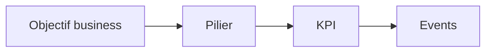

# AREA Framework

*Traduction de v0.1.0. La version anglaise fait référence : [English](README.md).*

**Un framework de tracking pour les apps mobiles, qui part des objectifs business et non des events.**

`v0.1.0` · Texte [CC BY 4.0](LICENSE), registre [CC0 1.0](registry/LICENSE) · [English](README.md) · Français



Chaque event existe parce qu'un KPI en a besoin, chaque KPI parce qu'il répond à la question d'un pilier, chaque pilier parce qu'un objectif business en dépend.

## Pourquoi AREA

Beaucoup d'apps mobiles traquent beaucoup et en apprennent peu. Les events s'empilent au fil des features, les frameworks habituels ne descendent pas jusqu'aux events, et les specs d'events disent quoi envoyer sans dire pourquoi. Le détail est dans le [manifeste](spec/fr/manifesto.md).

### D'où vient AREA

Je construis des apps mobiles, et je voulais mettre du tracking dans chacune d'elles de la même façon : une méthode qui fonctionne d'une app à l'autre, pas un plan refait à chaque fois. J'ai cherché un framework. J'ai trouvé [AARRR](https://www.slideshare.net/dmc500hats/startup-metrics-for-pirates-long-version) (Acquisition, Activation, Retention, Referral, Revenue), pensé pour la croissance d'une startup, [HEART](https://research.google.com/pubs/archive/36299.pdf) (Happiness, Engagement, Adoption, Retention, Task success), pensé pour l'expérience utilisateur d'un produit ou d'une feature, et des specs d'events qui disent quoi envoyer sans dire pourquoi. Les deux premiers vont de l'objectif à la métrique, puis laissent chaque projet construire ses events. Aucun ne proposait un socle commun, prêt à poser dans n'importe quelle app mobile. Alors j'en ai écrit un.

La question suivante est arrivée aussitôt : comment m'assurer que le tracking reste juste dans la durée ? Que se passe-t-il quand j'ajoute une feature, quand je change l'interface, quand j'en retire une ? Comment faire du tracking un outil de décision qui vit avec le projet, plutôt qu'un plan qui se périme au premier sprint ? Une partie de la réponse tient dans l'outillage (voir [plus bas](#outillage)). AREA, lui, s'applique sans aucun outil.

— Kevin Tersigni

## Les quatre piliers

| Pilier | La question à laquelle il répond | KPI de référence |
|---|---|---|
| [**Activation**](spec/fr/pillars/activation.md) | Les nouveaux utilisateurs atteignent-ils le moment où l'app prouve sa valeur ? | Taux d'activation |
| [**Rétention**](spec/fr/pillars/retention.md) | Reviennent-ils faire ce pour quoi l'app existe ? | Rétention cœur |
| [**Engagement**](spec/fr/pillars/engagement.md) | Quand ils sont là, utilisent-ils l'app pour ce qu'elle sait faire de mieux ? | Taux d'usage cœur |
| [**Advocacy**](spec/fr/pillars/advocacy.md) | Sont-ils prêts à la recommander ? | Taux d'intention de recommandation |

Chaque KPI de référence se lit avec son volume, et s'accompagne d'un verdict : mesurable, partiel ou non mesurable avec le tracking en place.

## Appliquer AREA

1. **Écrire l'objectif business de chaque pilier** pour votre app. Les pages des piliers en donnent un exemple type : chaque app écrit le sien, et c'est lui qui dit pourquoi le pilier compte.
2. **Définir l'action cœur** de l'app, puis son **aha moment**, comme une hypothèse à vérifier sur les données. Tout le reste en dépend ([Engagement](spec/fr/pillars/engagement.md), [Activation](spec/fr/pillars/activation.md)).
3. **Lister les mécaniques** de l'app : onboarding, paywall, autorisations, notifications, partage, parrainage… Chacune apporte ses events ([Minimum Viable Tracking](spec/fr/mvt.md)).
4. **Poser les Fondations** : identité, propriétés communes, consentement, séparation des données de test ([Fondations](spec/fr/foundations.md)).
5. **Implémenter le Minimum Viable Tracking** en suivant les [conventions](spec/fr/conventions.md).
6. **Lire les quatre KPI de référence**, leur volume et leur verdict, puis vérifier l'aha moment et ajouter les questions propres à l'app. Un verdict partiel ou non mesurable dit ce qu'il faut corriger d'abord. Jamais d'event sans question.

## Quand utiliser AREA

- **Avant la première ligne de code d'une nouvelle app**, pour écrire le plan de tracking.
- **Pour auditer une app existante** : son tracking permet-il de lire les quatre piliers ? Ses events existants peuvent garder leur nom et jouer les rôles du socle ([Minimum Viable Tracking](spec/fr/mvt.md#des-rôles-pas-seulement-des-noms)).
- **À chaque nouvelle feature**, pour la rattacher aux piliers plutôt que de lui inventer ses propres métriques.

AREA se pense à l'échelle de l'app entière. Une feature n'a pas son propre framework : elle se rattache aux quatre piliers, et ses questions propres s'ajoutent au-delà du Minimum Viable Tracking.

## Le Minimum Viable Tracking en bref

Le [Minimum Viable Tracking](spec/fr/mvt.md) est le tracking qu'AREA attend de toute app. Il se construit en trois couches : les Fondations, un socle de trois events commun à toutes les apps (`app_opened`, `aha_moment_reached`, `core_action_completed`), et les events des mécaniques que l'app contient. Pour une app courante, une douzaine d'events suffit à lire les quatre piliers.

## AREA et les autres frameworks

AREA ne remplace pas les frameworks existants. Il leur emprunte beaucoup, et ajoute ce qu'ils laissent à chaque projet : le plan d'events.

| | AARRR | HEART | AREA |
|---|---|---|---|
| Pour mesurer | La croissance d'une startup, de l'acquisition au revenu | L'expérience utilisateur | Le tracking d'une app mobile |
| Échelle | Le business | Le produit ou une feature | L'app entière |
| Ce qu'AREA lui emprunte | L'Activation, la Rétention, et le Referral devenu Advocacy | L'Engagement, et la chaîne objectif → signal → métrique | |
| De l'objectif aux events | Par un plan de mesure, à construire pour chaque projet | Par un plan de mesure (objectifs, signaux, métriques), à construire pour chaque produit ou feature | Intégré au framework : un socle commun de KPI et d'events, le même pour toutes les apps mobiles |
| Acquisition et revenu | Au cœur du modèle | Adoption seulement | Les décisions d'achat dans l'app ; ni l'acquisition ni les montants |
| Pensé pour le mobile | Non | Non | Oui |

**La différence tient en une ligne : avec AARRR ou HEART, chaque projet construit son plan de mesure ; avec AREA, la structure du plan existe déjà.** Chaque app écrit ses objectifs, définit son action cœur et son aha moment. Le reste du socle (les KPI de référence, leurs verdicts, les events et leurs propriétés) fait partie du framework. Une équipe n'a plus à le réinventer : elle le pose, puis elle consacre son temps à ce qui est propre à son app.

Il doit aussi beaucoup à d'autres travaux. Le North Star Framework a popularisé l'idée d'une action qui porte la valeur du produit, et Reforge le découpage de l'activation en trois moments : setup (l'app est prête à servir), aha (l'utilisateur en voit la valeur) et habit (il en fait une habitude). Côté events, la spec Segment et sa [Native Mobile Spec](https://www.twilio.com/docs/segment/connections/spec/mobile), comme les guides de taxonomie d'Amplitude et de Mixpanel, ont posé l'idée d'un vocabulaire d'events partagé. AREA relie les deux mondes : il part des questions de pilotage et descend jusqu'aux events, avec un socle commun aux apps mobiles.

## Les limites

- **AREA ne mesure ni l'acquisition ni le revenu.** Il trace les décisions d'achat prises dans l'app, jamais les montants. L'acquisition relève des outils d'attribution, le revenu du fournisseur de paiement.
- **Il ne mesure que ce que l'app voit.** La qualité perçue, l'avis laissé sur un store, la facilité d'un parcours se mesurent aussi par des enquêtes et des tests utilisateurs.
- **Il ne trouve pas l'action cœur à votre place.** C'est une décision produit, et tout le reste en dépend. L'aha moment, lui, reste une hypothèse tant qu'il n'a pas été vérifié sur les données.
- **Il dit si les KPI sont lisibles, pas quoi décider.** Ni cible, ni priorité entre les piliers : c'est le travail de l'équipe.
- **Ses écarts entre cohortes sont des corrélations**, pas des promesses de gain. Prouver un effet demande une expérience.
- **Ses KPI ne décrivent que les utilisateurs qui ont accepté la mesure**, quand un consentement est requis.
- **Il est pensé pour le mobile.** Le web n'est pas couvert dans cette version.
- **Il ne s'applique pas tel quel à toutes les apps.** Quelques cas demandent une adaptation :
  - les apps à valeur passive (VPN, sauvegarde, blocage d'appels), qui délivrent leur valeur sans action de l'utilisateur ;
  - les apps de bien-être numérique, pour qui moins d'usage peut être un succès ;
  - les marketplaces, où acheteurs et vendeurs ont chacun leur action cœur et leur aha moment ;
  - les apps financées par la publicité, qui vivent du volume d'usage plus que de l'action cœur.
- **Il est jeune.** Toutes ses entrées sont en `development`, et en version 0.x AREA ne garantit rien : tout peut encore évoluer.

## Ce qui vient ensuite

AREA est un socle, et ce socle n'est pas fini. La prochaine étape est une dimension transversale aux quatre piliers, qui permettra à chaque app d'ajouter ses propres objectifs : un parcours de conversion propre à son modèle économique, le lancement d'une feature, un objectif fixé par l'équipe. Chacun s'y décrira dans la grammaire d'AREA, avec ses KPI et ses events, sur le même socle.

Côté outillage, un skill pour les agents de code et un serveur MCP, publics eux aussi, permettront d'appliquer AREA directement depuis l'environnement de développement d'une app.

## Outillage

AREA se vérifie sans outil particulier :

- **Les verdicts se vérifient à la main.** Chaque page de pilier liste les conditions de chaque verdict : mesurable, partiel, non mesurable.
- **Le registre se valide avec un script** livré dans ce repo. Il demande PyYAML : `pip install pyyaml`, puis `python3 scripts/validate_registry.py`, ou en une commande avec uv : `uv run --with pyyaml python3 scripts/validate_registry.py`. Il contrôle les clés et valeurs vides (signe d'un YAML mal formé), le nommage, les noms réservés, le vocabulaire de verbes et la cohérence entre les fichiers du registre.

L'auteur développe aussi [supertrack](https://igniters.studio), un outil payant qui vérifie le tracking d'une app face à AREA à chaque pull request. AREA n'en dépend pas, et tout autre outil peut s'appuyer sur le registre.

## Contenu du repo

```
spec/          La spec : manifeste, conventions, fondations, piliers, Minimum Viable Tracking
registry/      La spec en version lisible par une machine (YAML)
scripts/       Le script qui valide le registre
references/    Les repères qui ne font pas partie de la spec, comme les benchmarks
```

## Versions et stabilité

AREA suit le versionnement sémantique. Chaque entrée du registre a un niveau de stabilité, et une entrée devient stable par l'usage : quand elle est implémentée dans au moins deux apps en production, dont une hors de l'équipe qui maintient AREA, que ses KPI ont été lus sur des données réelles, et qu'aucun retour ne la remet en cause. La règle complète est dans les [conventions](spec/fr/conventions.md#stabilité-et-versions), et chaque changement est noté dans le [changelog](CHANGELOG.md).

## Contribuer

Les retours d'apps qui appliquent AREA sont ce qui le fait avancer, et ce qui fait passer ses entrées en `stable`. Une question, une incohérence, un event qui ne tient pas dans votre app : ouvrez une issue ou une discussion.

## Licence et citation

- **Le texte** d'AREA (`spec/`, `references/`, ce README) est publié sous licence [CC BY 4.0](LICENSE). Vous pouvez le reprendre, l'adapter et l'utiliser commercialement, à condition de citer la source et d'indiquer vos modifications.
- **Le registre** (`registry/`) est publié sous licence [CC0 1.0](registry/LICENSE) : les noms d'events, de propriétés et de KPI se reprennent dans votre code et vos plans de tracking sans aucune condition.
- **Le script** (`scripts/`) est publié sous licence [Apache 2.0](scripts/LICENSE).

> AREA Framework, Kevin Tersigni, igniters — https://github.com/igniters-studio/area-framework
