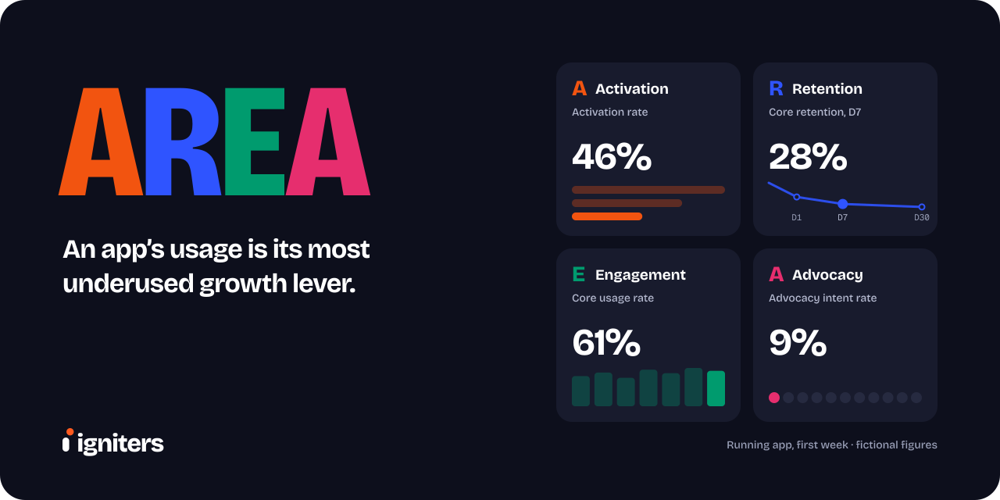
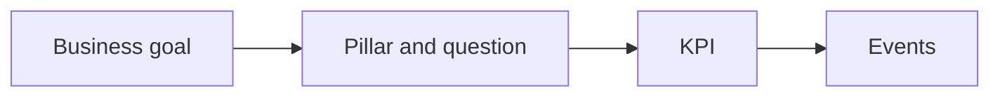

<p align="center"></p>

# AREA Framework

**An app's usage is its most underused growth lever.**

AREA tells you what to track and why: four pillars to steer any mobile app, a reference KPI for each, and the events that make them readable. Then everything else the app wants to know.

`v0.2.0` · Text [CC BY 4.0](LICENSE), registry [CC0 1.0](registry/LICENSE) · English · [Français](README.fr.md)



No event without a reason to exist: an event exists because a KPI needs it, a KPI because it answers a question, a question because a goal depends on it. It is the [Goal-Question-Metric](https://en.wikipedia.org/wiki/GQM) approach, taken all the way down to the event. The plan is designed from the goal down to the event, and read from the event back up to the goal.

## Why AREA

Many mobile apps track a lot and learn little. Events pile up with each feature, the usual frameworks stop before they reach events, and event specs say what to send without saying why. The details are in the [manifesto](spec/manifesto.md).

### Where AREA comes from

I build mobile apps, and I was looking for a tracking framework to measure the real usage of each of them, simply and in a standard way: one method that works from one app to the next, not a plan rebuilt every time. I found [AARRR](https://www.slideshare.net/dmc500hats/startup-metrics-for-pirates-long-version) (Acquisition, Activation, Retention, Referral, Revenue), built for startup growth, [HEART](https://research.google.com/pubs/archive/36299.pdf) (Happiness, Engagement, Adoption, Retention, Task success), built for the user experience of a product or a feature, and event specs that say what to send without saying why. The first two go from the goal to the metric, then leave each project to build its own events. None of the existing ones offered a common base, ready to set up in any mobile app. So I wrote one.

The next question came right away: how do I keep the tracking right over time? What happens when I add a feature, change the interface, or remove a feature? How do I make tracking a decision tool that lives with the project, rather than a plan that is out of date after the first sprint? Part of the answer lies in tooling (see [below](#tooling)). AREA itself applies without any tool.

— Kevin Tersigni, creator of AREA and founder of the igniters studio

## The four pillars

The pillars are the same for every app. What each app defines is its goals within them: for each pillar, AREA offers a typical goal, the question it raises, the reference KPI that answers it and the events that compute it.

| Pillar | Typical goal | The question | Reference KPI |
|---|---|---|---|
| [**Activation**](spec/pillars/activation.md) | Bring as many new users as possible to the app's value, as fast as possible | Do new users reach the moment when the app proves its value? | Activation rate |
| [**Retention**](spec/pillars/retention.md) | Bring users back, for a long time, for what the app gives them | Do they come back to do what the app exists for? | Core retention |
| [**Engagement**](spec/pillars/engagement.md) | Make the core action a habit, and know which features create value | When they are there, do they use the app for what it does best? | Core usage rate |
| [**Advocacy**](spec/pillars/advocacy.md) | Turn satisfied users into a lever for organic growth and product improvement | Are they ready to recommend it? | Advocacy intent rate |

Each reference KPI is read with its volume, and comes with a verdict: measurable, partial or not measurable with the tracking in place. Advocacy's can be read as soon as the app asks a satisfaction question, an NPS or offers an invitation: not every app does.

## Applying AREA

1. **Set the app's goals, pillar by pillar**, starting from the typical goals: each app writes its own, and they say why a pillar matters.
2. **Define the core action** of the app, then its **aha moment**, as a hypothesis to check against the data. Everything else depends on them ([Engagement](spec/pillars/engagement.md), [Activation](spec/pillars/activation.md)).
3. **Derive the KPIs**: the four reference KPIs first, then those of the app's own questions.
4. **List the mechanics** of the app: onboarding, permissions, notifications, sharing, referral… Each one brings its events ([Minimum Viable Tracking](spec/mvt.md)).
5. **Set up the [Foundations](spec/foundations.md) and implement Minimum Viable Tracking**: identity, common properties, consent, separation of test data, then the events, following the [conventions](spec/conventions.md).
6. **Check that every KPI is measurable**: measurable, partial or not measurable, the verdict says whether the right events come in and what to fix first. The KPIs are then read in the team's analytics or BI tool, where the aha moment gets checked. Never an event without a question.

## When to use AREA

- **Before the first line of code of a new app**, to write the tracking plan.
- **To audit an existing app**: can its tracking read the four pillars? Its existing events can keep their names and play the roles of the core ([Minimum Viable Tracking](spec/mvt.md#roles-not-just-names)).
- **With each new feature**, to attach it to the pillars rather than invent its own metrics.

AREA works at the scale of the whole app. A feature does not get its own framework: it attaches to the four pillars, and its own questions are added beyond Minimum Viable Tracking.

## Minimum Viable Tracking in brief

A few well-chosen events are enough to decide. [Minimum Viable Tracking](spec/mvt.md) is the smallest plan that makes the pillars readable. It is built in three layers: the Foundations, a core of three events required in every app (`app_opened`, `aha_moment_reached`, `core_action_completed`), and the events of the mechanics the app contains. A mechanic is a feature the app either has or doesn't: an onboarding, notifications, a permission request, a referral… If the app has it, its events join the plan. For a typical app, about a dozen events are enough to read the four pillars.

## AREA and other frameworks

AREA does not replace existing frameworks. It borrows a lot from them, and adds what they leave to each project: the event plan.

| | AARRR | HEART | AREA |
|---|---|---|---|
| Measures | Startup growth, from acquisition to revenue | User experience | How a mobile app is used |
| Scale | The business | The product or a feature | The whole app |
| What AREA borrows from it | Activation, Retention, and Referral, which became Advocacy | Engagement, and the goal → signal → metric chain | |
| From goals to events | Through a measurement plan, built for each project | Through a measurement plan (goals, signals, metrics), built for each product or feature | Built into the framework: a common base of KPIs and events, the same for every mobile app |
| Acquisition and revenue | At the heart of the model | Adoption only | Outside the pillars. Journeys specific to the business model (monetization, for instance) come in a later version |
| Designed for mobile | Generic | Generic | Yes |

**The difference fits in one line: with AARRR or HEART, each project builds its measurement plan; with AREA, the structure of the plan already exists.** Each app writes its goals, defines its core action and its aha moment. The rest of the common base (the reference KPIs, their verdicts, the events and their properties) is part of the framework. A team no longer has to reinvent it: it sets it up, then spends its time on what is specific to its app.

AREA also owes a lot to other work. The North Star Framework made popular the idea of one action that carries the product's value, and Reforge the split of activation into three moments: setup (the app is ready to serve), aha (the user sees its value) and habit (the user makes it a habit). On the event side, the Segment spec and its [Native Mobile Spec](https://www.twilio.com/docs/segment/connections/spec/mobile), like the taxonomy guides of Amplitude and Mixpanel, set out the idea of a shared event vocabulary. AREA connects the two worlds: it starts from the questions that steer the product and goes down to the events, with a base shared by mobile apps.

## Limits

- **AREA measures neither acquisition nor revenue.** Its four pillars carry neither the paywall nor purchases: not every app has a paid offer. Purchase decisions made in the app will come with the cross-cutting dimension (see [What comes next](#what-comes-next)). Acquisition belongs to attribution tools, revenue to the payment provider.
- **It only measures what the app sees.** Perceived quality, a store review, how easy a flow is: these are also measured with surveys and user tests.
- **It does not find the core action for you.** It is a product decision, and everything else depends on it. The aha moment stays a hypothesis until it has been checked against the data.
- **It says whether the KPIs can be read, not what to decide.** No targets, no priority between the pillars: that is the team's job.
- **Its gaps between cohorts are correlations**, not promised gains. Proving an effect takes an experiment.
- **Its KPIs only describe the users who accepted measurement**, when consent is required.
- **It is designed for mobile.** The web is not covered in this version.
- **It does not apply as is to every app.** A few cases need adapting:
  - apps with passive value (VPN, backup, call blocking), which deliver their value without any user action;
  - digital wellbeing apps, for which less usage can be a success;
  - marketplaces, where buyers and sellers each have their own core action and aha moment;
  - ad-funded apps, which live on usage volume more than on the core action.
- **It is young.** All its entries are in `development`, and in version 0.x AREA guarantees nothing: everything can still change.

## What comes next

AREA is a common base, and this base is not finished. The next step is a dimension that cuts across the four pillars, so that each app can add its own goals: a conversion flow specific to its business model (the paywall and purchases, for instance), a feature launch, a goal set by the team. Each will be described in AREA's grammar, with its KPIs and events, on the same base.

On the tooling side, a toolkit will follow this first version. It starts with React Native and Expo apps: the stack where its audits and fixes can be guaranteed right. Native iOS, native Android and Flutter will follow; the framework itself depends on no stack.

- **area-core** (in the works): an open-source toolkit, under Apache 2.0, that applies AREA to an app's repo, locally, with the developer's own coding agent. It brings deterministic checks that need no LLM (naming conventions, [Minimum Viable Tracking](spec/mvt.md) and its score), skills that audit the tracking and recommend fixes, and the MCP server that serves the framework to coding agents.

## Tooling

AREA can be checked without any particular tool:

- **Verdicts are checked by hand.** Each pillar page lists the conditions of each verdict: measurable, partial, not measurable.
- **The registry is on npm**, as the package [`area-framework`](https://www.npmjs.com/package/area-framework): the registry as JSON, and TypeScript types generated from it (events, properties and their closed lists, KPIs). Its version is the version of AREA, so an app pins the version it follows, and a rename in the registry becomes a type error in its build.
- **The registry is validated by the same package**: `npx area-framework validate registry` from a clone of this repo, or `yarn check` in `package/`. It checks empty keys and values (a sign of malformed YAML), naming, reserved names, the verb vocabulary and consistency between the registry files, and runs on every pull request.

The author builds area-core, announced in [What comes next](#what-comes-next). AREA does not depend on it, and any other tool can build on the registry.

## Repository contents

```
spec/          The spec: manifesto, conventions, foundations, pillars, Minimum Viable Tracking
spec/fr/       The French translation of the spec
registry/      The spec in machine-readable form (YAML)
package/       The npm package area-framework: the registry as JSON, its TypeScript types and its validator
site/          The website, a static export of the spec published on GitHub Pages
references/    Reference points that are not part of the spec, such as benchmarks
```

## Versions and stability

AREA follows semantic versioning. Each registry entry has a stability level, and an entry becomes stable through use: when it is implemented in at least two apps in production, at least one of them outside the team that maintains AREA, when its KPIs have been read on real data, and when no feedback questions it. The full rule is in the [conventions](spec/conventions.md#stability-and-versions), and every change is recorded in the [changelog](CHANGELOG.md).

## Contributing

Feedback from apps that apply AREA is what moves it forward, and what moves its entries to `stable`. A question, an inconsistency, an event that does not fit your app: open a [discussion](https://github.com/igniters-studio/area-framework/discussions).

AREA depends on no stack, but its tooling starts with React Native and Expo. Feedback from native iOS, native Android and Flutter apps is valuable: what changes from one stack to another (where to send `app_opened`, how to know its `entry_point`, the core action done from a widget or an extension), with no new events. The details are in the [contributing guide](CONTRIBUTING.md).

## License and citation

- **The text** of AREA (`spec/`, `references/`, this README) is published under the [CC BY 4.0](LICENSE) license. You can reuse it, adapt it and use it commercially, as long as you credit the source and state your changes.
- **The registry** (`registry/`) is published under the [CC0 1.0](registry/LICENSE) license: event, property and KPI names can be reused in your code and tracking plans with no conditions at all.
- **The package's code** (`package/`) and **the website's code** (`site/`) are published under the [Apache 2.0](package/LICENSE) license. The registry data the package ships stays under CC0 1.0.

> AREA Framework, Kevin Tersigni, igniters — https://github.com/igniters-studio/area-framework
