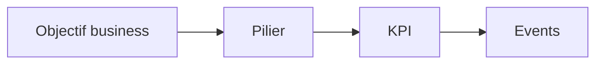

# Manifeste

*Traduction de v0.2.0. La version anglaise fait référence : [English](../manifesto.md).*

**Un framework de tracking pour les apps mobiles, qui part des objectifs business et non des events.**

## Le problème

Beaucoup d'apps mobiles traquent beaucoup et en apprennent peu. Les events s'empilent au fil des features, chacun nommé par la personne qui a écrit le code. Un an plus tard, personne ne sait plus à quelle question business répond chaque event, quels KPI sont fiables, ni ce qui manque.

Le problème ne vient pas d'un manque de méthode. Les équipes sérieuses commencent par un plan de mesure : une North Star, des objectifs, des signaux, des métriques, puis la liste des events à implémenter. Sur le papier, la démarche est la bonne. Sur une app mobile, elle déraille souvent de la même façon :

- **Le plan de mesure suit l'arborescence de l'app.** Chaque feature reçoit ses objectifs, ses métriques et ses events. Le tracking finit par décrire l'app écran par écran, et le volume de données remplace la compréhension.
- **L'essentiel reste flou.** L'action qui prouve la valeur de l'app n'est pas définie, pendant que des dizaines de métriques secondaires sont détaillées. L'activation et la rétention se comptent en sessions plutôt qu'en utilisateurs.
- **Les events décrivent des taps, pas des résultats.** « Tracer le tap sur le bouton » produit des données qui cassent au premier redesign, et ne disent pas si l'utilisateur a obtenu ce qu'il venait chercher.
- **Les réflexes du web sont transposés tels quels.** Nombre de clics pour atteindre une fonction, pages vues, sessions : sur mobile, on arrive par une notification, un widget ou un lien profond, et ces métriques perdent leur sens.
- **Ce que l'app voit et ce qu'elle ne voit pas sont mélangés.** Téléchargements, note sur les stores, tickets au support : ce sont des objectifs légitimes, mais aucun event envoyé par l'app ne les mesure. Le plan promet des KPI que le tracking ne peut pas livrer.
- **Les fondations arrivent en dernier.** L'identifiant utilisateur, les propriétés communes et le consentement conditionnent la fiabilité de tous les KPI, mais ils sont traités en fin de projet, quand ils le sont.

Ces dérives ont une cause commune : chaque plan de mesure reconstruit sa structure à partir de zéro. Rien ne garantit qu'elle couvre ce que fait un utilisateur mobile, ni qu'elle commence par l'essentiel. Et les specs d'events standard ne comblent pas le manque : elles disent quoi envoyer, rarement pourquoi.

## La chaîne

AREA garde la logique d'un plan de mesure, de l'objectif jusqu'à l'event. Chaque app écrit ses propres objectifs business. Ce qu'AREA fixe, c'est la structure que chaque projet réinventait : quatre piliers communs à toutes les apps mobiles, définis en premier, un KPI de référence pour chacun, et des events qui décrivent des résultats.

Un event existe parce qu'un KPI en a besoin. Un KPI existe parce qu'il répond à la question d'un pilier. Un pilier compte parce qu'un objectif business en dépend. Lue de droite à gauche, la chaîne dit pourquoi chaque ligne de code de tracking existe.

## Les quatre piliers

| Pilier | La question à laquelle il répond |
|---|---|
| **Activation** | Les nouveaux utilisateurs atteignent-ils le moment où l'app prouve sa valeur ? |
| **Rétention** | Reviennent-ils faire ce pour quoi l'app existe ? |
| **Engagement** | Quand ils sont là, utilisent-ils l'app pour ce qu'elle sait faire de mieux ? |
| **Advocacy** | Sont-ils prêts à la recommander ? |

Les piliers ne sont pas nouveaux : l'Activation, la Rétention et le Referral, devenu Advocacy, viennent d'AARRR ; l'Engagement vient de HEART. Ce qui est nouveau, c'est de les poser comme un tronc commun pour les apps mobiles, avec leurs KPI et leurs events. Ils s'appliquent à la plupart des apps, quel que soit leur modèle économique ; les cas où ils ne s'appliquent pas tels quels sont listés dans [les limites](../../README.fr.md#les-limites) du README. Les features de l'app ne créent pas de nouveaux piliers : elles se rattachent aux quatre existants.

## Les principes

1. **Le business d'abord.** Pas d'event sans KPI, pas de KPI sans question.
2. **L'essentiel en premier.** L'action qui prouve la valeur de l'app est définie avant toute autre métrique. Tant qu'elle ne l'est pas, aucun KPI ne tient.
3. **Un minimum, pas une checklist.** Le Minimum Viable Tracking est court et s'applique à toutes les apps. Tout ce qui va au-delà doit répondre à une question propre à l'app.
4. **Des résultats, pas des taps.** Un event décrit ce que l'utilisateur a obtenu, pas le bouton qu'il a touché. Il survit ainsi aux redesigns.
5. **Les fondations avant les piliers.** L'identité, les propriétés communes et le consentement passent en premier : s'ils sont cassés, tous les KPI sont faux.
6. **Honnête sur ce que l'app peut voir.** AREA ne s'appuie que sur les events envoyés depuis l'app. Ce que l'app ne peut pas mesurer de façon fiable est hors périmètre, et c'est dit. Une corrélation est présentée comme une corrélation.
7. **Portable d'un outil à l'autre.** AREA dit quoi traquer, pas avec quel outil d'analytics, quel SDK ou quel framework. Ses contraintes de nommage sont calées sur l'outil le plus strict, pour qu'un plan reste valide partout.
8. **Versionné.** Chaque entrée a un niveau de stabilité, et AREA évolue par versions numérotées. Un plan de tracking peut ainsi indiquer quelle version il suit.

## Hors périmètre

- **L'acquisition et l'attribution.** D'où viennent les utilisateurs se mesure avec des outils d'attribution, pas avec des events in-app.
- **La monétisation et le revenu.** Les quatre piliers ne portent ni la paywall ni l'achat : toutes les apps n'ont pas d'offre payante. Les décisions d'achat prises dans l'app viendront avec la dimension transversale d'une version suivante. Combien paient les utilisateurs, les renouvellements et les remboursements se lisent chez le fournisseur de paiement.
- **Ce qui se passe hors de l'app.** L'Advocacy mesure l'intention de recommander captée dans l'app, pas l'avis sur le store qui suivra peut-être. La satisfaction déclarée dans une enquête externe ou le volume de tickets au support relèvent d'autres outils.
- **La santé technique.** Disponibilité, temps de réponse et crashs relèvent du monitoring, pas du tracking produit.
- **La décision.** AREA dit si les KPI sont lisibles et comment les lire. Il ne fixe ni cible ni priorité entre les piliers : c'est le travail de l'équipe produit.

## Ce que contient cette version

- Les quatre piliers, chacun avec son KPI de référence
- Les fondations
- Les conventions de nommage des events et des propriétés
- Le Minimum Viable Tracking, dérivé des KPI
- Un registre lisible par une machine de tout ce qui précède, et un script qui le valide

Cette version pose la base commune à toutes les apps mobiles. Les versions suivantes ajouteront une dimension transversale aux piliers, pour que chaque app y décrive ses propres objectifs (un parcours propre à son modèle économique, le lancement d'une feature, un objectif d'équipe) avec ses KPI et ses events, sur la même base.

## Pour qui

Les founders, les product managers et les développeurs mobiles qui veulent que leur tracking réponde à des questions business, et qu'il continue d'y répondre à mesure que l'app évolue.

---

Créé par Kevin Tersigni chez [igniters](https://igniters.studio). Texte sous licence [CC BY 4.0](https://creativecommons.org/licenses/by/4.0/deed.fr), registre sous licence [CC0 1.0](https://creativecommons.org/publicdomain/zero/1.0/deed.fr).
