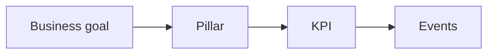

# Manifesto

**A tracking framework for mobile apps that starts from business goals, not from events.**

## The problem

Many mobile apps track a lot and learn little. Events pile up with each feature, each one named by whoever wrote the code. A year later, nobody knows which business question each event answers, which KPIs can be trusted, or what is missing.

The problem is not a lack of method. Serious teams start with a measurement plan: a North Star, goals, signals, metrics, then the list of events to implement. On paper, the approach is right. On a mobile app, it often goes wrong in the same ways:

- **The measurement plan follows the app's screen tree.** Each feature gets its goals, its metrics and its events. The tracking ends up describing the app screen by screen, and data volume replaces understanding.
- **The essentials stay vague.** The action that proves the app's value is not defined, while dozens of secondary metrics are detailed. Activation and retention are counted in sessions rather than in users.
- **Events describe taps, not outcomes.** "Track the tap on the button" produces data that breaks at the first redesign, and does not say whether the user got what they came for.
- **Web habits are copied as is.** Number of clicks to reach a feature, page views, sessions: on mobile, users arrive through a notification, a widget or a deep link, and these metrics lose their meaning.
- **What the app sees and what it does not see are mixed up.** Downloads, store ratings, support tickets: these are valid goals, but no event sent by the app measures them. The plan promises KPIs the tracking cannot deliver.
- **The foundations come last.** The user identifier, the common properties and consent decide how reliable every KPI is, but they are handled at the end of the project, if at all.

These problems share one cause: each measurement plan rebuilds its structure from scratch. Nothing ensures it covers what a mobile user does, or that it starts with the essentials. And standard event specs do not fill the gap: they say what to send, rarely why.

## The chain

AREA keeps the logic of a measurement plan, from the goal down to the event. Each app writes its own business goals. What AREA sets is the structure each project used to reinvent: four pillars shared by all mobile apps, defined first, one reference KPI for each, and events that describe outcomes.

An event exists because a KPI needs it. A KPI exists because it answers a pillar's question. A pillar matters because a business goal depends on it. Read from right to left, the chain says why each line of tracking code exists.

## The four pillars

| Pillar | The question it answers |
|---|---|
| **Activation** | Do new users reach the moment when the app proves its value? |
| **Retention** | Do they come back to do what the app exists for? |
| **Engagement** | When they are there, do they use the app for what it does best? |
| **Advocacy** | Are they ready to recommend it? |

The pillars are not new: Activation, Retention and Referral, which became Advocacy, come from AARRR; Engagement comes from HEART. What is new is setting them as a common trunk for mobile apps, with their KPIs and their events. They apply to most apps, whatever their business model; the cases where they do not apply as is are listed in [the limits](../README.md#limits) of the README. The app's features do not create new pillars: they attach to the four existing ones.

## Principles

1. **Business first.** No event without a KPI, no KPI without a question.
2. **Essentials first.** The action that proves the app's value is defined before any other metric. Until it is, no KPI holds.
3. **A minimum, not a checklist.** Minimum Viable Tracking is short and applies to every app. Anything beyond it must answer a question specific to the app.
4. **Outcomes, not taps.** An event describes what the user got, not the button they touched. That way it survives redesigns.
5. **Foundations before pillars.** Identity, common properties and consent come first: if they are broken, every KPI is wrong.
6. **Honest about what the app can see.** AREA relies only on events sent from the app. What the app cannot measure reliably is out of scope, and AREA says so. A correlation is presented as a correlation.
7. **Portable from one tool to another.** AREA says what to track, not with which analytics tool, SDK or framework. Its naming constraints follow the strictest tool, so that a plan stays valid everywhere.
8. **Versioned.** Each entry has a stability level, and AREA evolves through numbered versions. A tracking plan can state which version it follows.

## Out of scope

- **Acquisition and attribution.** Where users come from is measured with attribution tools, not with in-app events.
- **Revenue amounts.** AREA measures the purchase decisions made in the app: the paywall shown, the trial started, the purchase made. How much users pay, renewals and refunds are read at the payment provider.
- **What happens outside the app.** Advocacy measures the intent to recommend captured in the app, not the store review that may follow. Satisfaction reported in an external survey or the volume of support tickets belong to other tools.
- **Technical health.** Uptime, response times and crashes belong to monitoring, not to product tracking.
- **Decisions.** AREA says whether the KPIs can be read and how to read them. It sets no targets and no priority between the pillars: that is the product team's job.

## What this version contains

- The four pillars, each with its reference KPI
- The Foundations
- The naming conventions for events and properties
- Minimum Viable Tracking, derived from the KPIs
- A machine-readable registry of all of the above, and a script that validates it

This version sets the core shared by all mobile apps. Later versions will add a dimension that cuts across the pillars, so that each app can describe its own goals there (a flow specific to its business model, a feature launch, a team goal) with its KPIs and events, on the same core.

## Who it is for

Founders, product managers and mobile developers who want their tracking to answer business questions, and to keep answering them as the app evolves.

---

Created by Kevin Tersigni at [igniters](https://igniters.studio). Text under the [CC BY 4.0](https://creativecommons.org/licenses/by/4.0/) license, registry under the [CC0 1.0](https://creativecommons.org/publicdomain/zero/1.0/) license.
